<!--
manual: trace
modulo: CONTROL TRACE
version: v192
actualizado: 2026-10-29
sugerencias: ¿Cómo anulo un remito?; ¿Por qué no me aparece el stock de un producto que ya produje?; ¿Qué hago si el lote que quiero usar no es el más viejo?; ¿Cómo cargo un pedido desde la orden de compra del cliente?
-->
# Manual del usuario · CONTROL TRACE

CONTROL TRACE es el módulo de **trazabilidad y producción** de CONTROL MAX. Registra todo lo que pasa con la mercadería, desde que entra hasta que sale hacia el cliente, y permite reconstruir la historia completa de cada lote.

Este manual explica cada pantalla paso a paso. Cada tema indica qué roles lo usan. Los ejemplos usan una empresa de demostración: los nombres, productos y números son ficticios.

## Qué es CONTROL TRACE y cómo se usa
<!-- id: introduccion | grupo: Primeros pasos | roles: todos | resumen: El circuito completo, de la recepción a la entrega -->
CONTROL TRACE sigue a la mercadería en todo su recorrido. Cada movimiento queda asociado a un **lote**, y por eso en cualquier momento podés saber de dónde vino un producto y a qué cliente fue.

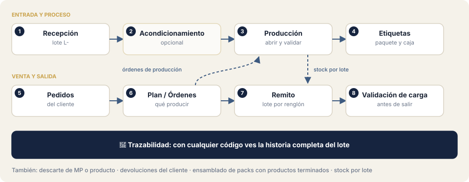

### El recorrido típico
1. **Recepción**: llega la materia prima (MP) y el sistema le da un número de lote, por ejemplo `L-00012`.
2. **Acondicionamiento** (opcional): un primer proceso sobre la MP, como pelar, lavar o cortar, que genera un lote intermedio.
3. **Producción**: con la MP de un lote se elaboran productos terminados. Se abre una orden de producción (`P-00034`) y, al terminar, se valida.
4. **Etiquetas**: se imprimen las etiquetas de paquete y de caja con el lote real.
5. **Pedidos y plan**: se cargan los pedidos de los clientes y se planifica qué producir y qué comprar.
6. **Remito**: se arma la entrega al cliente eligiendo de qué lote sale cada producto.
7. **Validación de carga**: antes de que salga el camión se controlan las cajas.
8. **Trazabilidad**: con cualquier código (lote, producción, remito) se ve la historia completa.

### Códigos que vas a ver
| Código | Qué es | Ejemplo |
|---|---|---|
| L- | Lote de materia prima (recepción) | L-00012 |
| L-…·1 | Lote intermedio de un acondicionamiento | L-00012·1 |
| P- | Orden de producción | P-00034 |
| PR- | Producto resultante de una producción | PR-00051 |
| E- | Ensamblado (pack armado con productos terminados) | E-00003 |
| D- | Etiquetado / despacho | D-00020 |
| OP- | Orden de producción enviada desde pedidos | OP-00007 |
| PED- | Pedido de cliente | PED-00110 |
| DEV- | Devolución | DEV-00004 |
| 0001-00000123 | Remito (punto de venta + número) | 0001-00000123 |

> 💡 Lo que ves en el menú depende de tu rol. Si te falta una pantalla que necesitás, pedile al administrador que te dé el permiso en **Configuración CONTROL MAX**.

## Ingresar, moverse por el sistema y cerrar sesión
<!-- id: ingreso | grupo: Primeros pasos | roles: todos | resumen: Portal, menú, barra superior, actualizar datos y contraseña -->
### Ingresar
1. Entrá al portal de CONTROL MAX con tu correo y contraseña.
2. Tocá la tarjeta **CONTROL TRACE**. Si ya tenías la sesión abierta, entrás directo.

> ⚠️ Si al entrar te aparece "Tu usuario está inactivo", el administrador te dio de baja. Hablá con él para que te reactive.

### Moverse por el sistema
- **Menú de la izquierda**: tiene las pantallas agrupadas en *Operaciones*, *Administración* y *Análisis*. Solo aparecen las que tu rol puede usar.
- **Arriba al centro** está la barra de CONTROL MAX:
  - **🏠 CONTROL MAX** vuelve al portal.
  - **⧉ Nueva pestaña** abre otra pestaña del navegador con esta misma pantalla, el portal o cualquier módulo, sin volver a ingresar.
  - **📖 Manual** abre este manual (también con la tecla **F1**).
- **🔄 Actualizar**, arriba a la derecha, trae lo último que cargaron otras personas. Además, cuando volvés a la pestaña de TRACE después de usar otra, la pantalla se actualiza sola.
- Los avisos aparecen arriba unos segundos: en verde si salió bien, en amarillo si hay algo para revisar y en rojo si hubo un error.

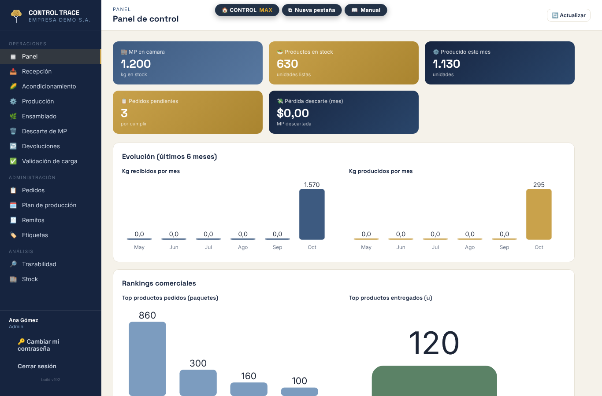

### Atajos de teclado
- **Enter** en un campo del formulario aprieta el botón principal (el dorado) de esa tarjeta o ventana.
- En pedidos y remitos: Enter en la cantidad te lleva al precio, y Enter en el precio agrega un renglón nuevo.
- **Esc** cierra el manual.

### Cambiar tu contraseña
1. En la barra de la izquierda, abajo, tocá **🔑 Cambiar mi contraseña**.
2. Escribí la contraseña nueva dos veces (mínimo 6 caracteres).
3. Tocá **Guardar**. Seguís con la sesión abierta.

> 💡 Si te olvidaste la contraseña, pedile al administrador que te la blanquee desde Configuración CONTROL MAX y después cambiala vos.

### Cerrar sesión
Tocá **Cerrar sesión**, abajo en la barra de la izquierda. Hacelo siempre si la computadora la usan otras personas.

## Listas, filtros y períodos
<!-- id: listas | grupo: Primeros pasos | roles: todos | resumen: Seleccionar registros, acciones, Excel, imprimir y filtrar por fecha -->
Casi todas las pantallas tienen una lista de lo cargado (recepciones, producciones, remitos, pedidos…). Todas funcionan igual.

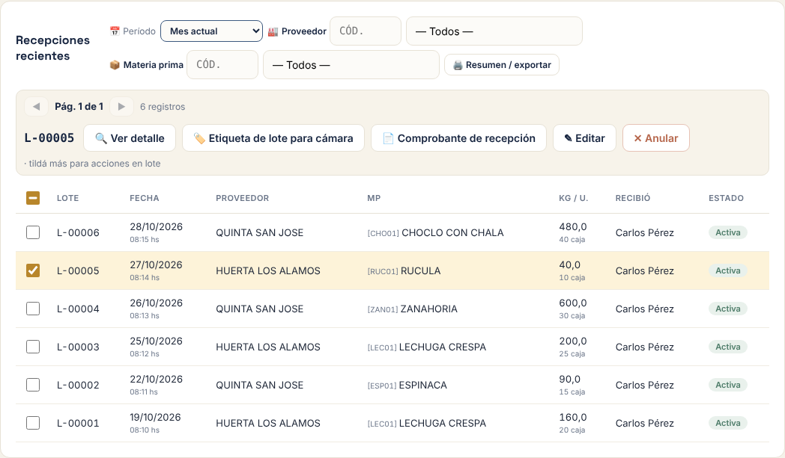

### Elegir un registro y ver sus acciones
1. Hacé clic en la fila del registro. Queda resaltada.
2. Arriba de la lista aparecen botones grandes con lo que podés hacer con ese registro: **Ver**, **Editar**, **Anular**, **Etiqueta**, **Comprobante**, etc.
3. Para deseleccionarlo, volvé a hacer clic en la fila.

### Trabajar con varios a la vez
1. Tildá la casilla de cada fila (o usá **Ctrl** o **Shift** + clic). La casilla del encabezado tilda todos los de la página.
2. Con dos o más tildados aparecen las **acciones en lote**:
   - **📥 Excel**: descarga los tildados en una planilla.
   - **🖨️ Imprimir listado**: imprime los tildados en A4.
   - Según la pantalla: **🏷️ Etiquetas de los lotes** (Recepción), **🖨️ Imprimir remitos** (Remitos), **✓ Confirmar pedidos**, **🏭 Enviar a producción**, **✓ Marcar entregados** o **🚫 No entregados** (Pedidos).
3. **Tildar los N** tilda todos los registros del filtro, y **✕ Destildar** limpia la selección.

### Páginas
Las listas muestran 8 registros por página. Usá **◀** y **▶** para pasar de página. Al lado ves cuántos registros hay en total.

### Período
El selector **📅 Período** elige qué fechas se muestran: *Hoy*, *Mes actual*, *Mes anterior*, *Últimos 3 meses*, *Año actual*, *Todo el histórico* o *Fecha específica*. Con *Fecha específica* elegís desde y hasta, y tocás **Aplicar**. En Producción hay además *Recientes (hoy + abiertas)*, que es la opción por defecto.

### Buscar por código o por nombre
Los campos de artículo, cliente y proveedor tienen dos casillas: **código** y **nombre**.
- Si sabés el código, escribilo y apretá **Enter**: el nombre se completa solo.
- Si no, empezá a escribir el nombre y elegilo de la lista: el código se completa solo.
- En los filtros, elegir un artículo filtra exactamente ese artículo. Si escribís un texto suelto, busca todo lo que lo contenga.

## PIN de supervisor
<!-- id: pin | grupo: Primeros pasos | roles: todos | resumen: Qué operaciones lo piden y dónde queda registrado -->
Las operaciones que cambian algo ya registrado, o que se salen de la regla, piden el **PIN del supervisor**. Así nadie puede modificar el stock sin autorización.

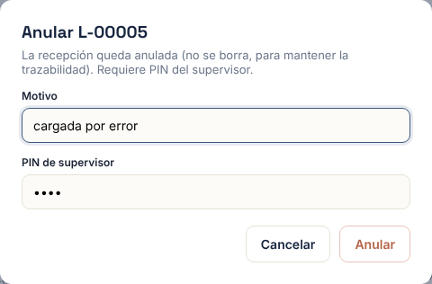

### Qué operaciones lo piden
- Editar o anular una recepción, un acondicionamiento, una producción, un ensamblado, un descarte, una devolución, un despacho o un remito.
- Desbloquear una producción ya validada.
- Procesar un lote salteando el orden **PEPS** (primero entra, primero sale).
- Registrar un descarte.
- Asignar a un remito un lote que queda con stock negativo.
- Validar una carga con diferencias.

### Cómo se usa
1. Escribí el PIN en el campo **PIN de supervisor**. Si el supervisor tiene un **QR de autorización** impreso, podés escanearlo en ese campo: equivale a tipear el PIN.
2. Completá el motivo cuando lo pide.
3. Tocá el botón de la operación. Si el PIN es incorrecto, aparece "PIN incorrecto" y no se hace nada.

> 🔒 Cada operación autorizada con PIN queda registrada en **Novedades**: qué se hizo, sobre qué registro, quién la autorizó y quién la ejecutó. Ese registro se consulta en CONTROL TOTAL (Auditoría).

> 💡 Los PIN y los autorizadores se configuran en **Configuración CONTROL MAX**.

## Lector de códigos (escáner)
<!-- id: lector | grupo: Primeros pasos | roles: todos | resumen: Dónde se escanea y qué pasa si el lector cambia el guion -->
Los campos que dicen **📷 Escanear** aceptan el lector de códigos de barras o QR. El lector escribe el código y aprieta Enter solo.

Se puede escanear en:
- **Acondicionamiento** y **Producción**: la etiqueta del lote de MP.
- **Descarte**: el lote de MP o de producto.
- **Devoluciones**: el lote del producto devuelto.
- **Validación de carga**: el QR de cada caja.
- **Trazabilidad**: cualquier código.
- **Producción** (filtro de la lista): un lote o una orden.
- El campo **PIN**: el QR de autorización del supervisor.

> 💡 Algunos lectores, según el idioma del teclado, escriben `L'00017` o `L/00017` en vez de `L-00017`. No hace falta corregirlo: el sistema lo reconoce igual.

## Qué ve cada rol
<!-- id: roles | grupo: Primeros pasos | roles: todos | resumen: Pantallas habilitadas por rol -->
Esta es la configuración de fábrica. El administrador puede cambiarla para su empresa en Configuración CONTROL MAX, así que en tu empresa puede ser distinta.

| Pantalla | Administrador | Supervisor | Comercial | Preparador | Chofer |
|---|---|---|---|---|---|
| Panel | ✓ | ✓ | ✓ | ✓ | |
| Recepción | ✓ | ✓ | | ✓ | |
| Acondicionamiento | ✓ | ✓ | | ✓ | |
| Producción | ✓ | ✓ | | ✓ | |
| Ensamblado | ✓ | ✓ | | ✓ | |
| Descarte de MP | ✓ | ✓ | | ✓ | |
| Devoluciones | ✓ | ✓ | ✓ | | |
| Validación de carga | ✓ | ✓ | | | ✓ |
| Pedidos | ✓ | ✓ | ✓ | | |
| Plan de producción | ✓ | ✓ | ✓ | ✓ | |
| Remitos | ✓ | ✓ | ✓ | | |
| Etiquetas | ✓ | ✓ | | ✓ | |
| Trazabilidad | ✓ | ✓ | ✓ | ✓ | |
| Stock | ✓ | ✓ | ✓ | ✓ | |

> 💡 Los **precios de compra** de la recepción solo los ven el administrador y los roles habilitados en Configuración CONTROL MAX. Para el resto, esos campos no aparecen.

## Panel de control
<!-- id: panel | grupo: Operaciones | pantalla: dash | roles: admin, supervisor, comercial, preparador | resumen: Resumen del día y avisos -->
Es la primera pantalla al entrar. Muestra cómo está la planta sin tener que buscar nada.

### Indicadores
- **🏬 MP en cámara**: kilos de materia prima en stock.
- **🥗 Productos en stock**: unidades de producto terminado listas para entregar.
- **⚙️ Producido este mes**: unidades producidas en el mes (sin contar reventas).
- **📋 Pedidos pendientes**: pedidos que todavía no se entregaron.
- **💸 Pérdida descarte (mes)**: valor de la MP descartada en el mes.

### Avisos
- **Insumos en stock bajo**: insumos que llegaron a su stock mínimo.
- **Producciones abiertas hace más de 24 h**: tocá el aviso para ir a Producción y cerrarlas o anularlas.
- Al entrar, si hay **órdenes de producción por ejecutar**, aparece un aviso arriba y un número dorado al lado de *Producción* en el menú.

### Gráficos
- **Evolución (últimos 6 meses)**: kilos recibidos y kilos producidos por mes.
- **Rankings comerciales**: los productos más pedidos y los más entregados.

## Recepción de mercadería
<!-- id: recepcion | grupo: Operaciones | pantalla: rec | roles: admin, supervisor, preparador | resumen: Registrar la MP que llega, etiqueta de lote, comprobante, editar y anular -->
Acá se registra todo lo que entra. Cada recepción genera un **lote** (`L-00001`, `L-00002`…), que es el punto de partida de la trazabilidad.

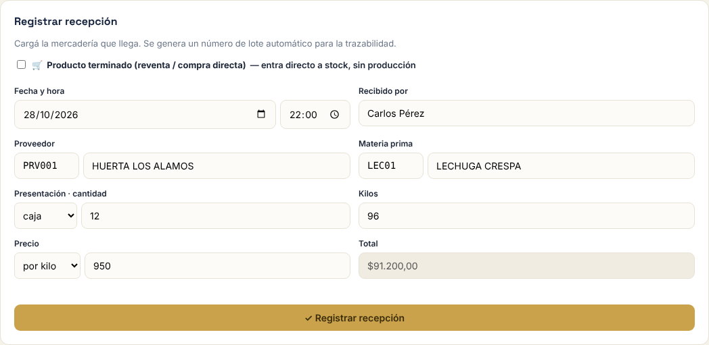

### Registrar una recepción de materia prima
1. Revisá la **Fecha y hora**: vienen con la fecha y hora actuales.
2. En **Recibido por**, escribí quién recibe la mercadería (es obligatorio).
3. Elegí el **Proveedor** y la **Materia prima** (por código o por nombre).
4. En **Presentación · cantidad**, elegí cómo viene (caja, bolsa, paquete, unidad o bulto) y cuántos bultos llegaron.
5. Cargá los **Kilos** pesados (obligatorio).
6. Si ves el precio, elegí **por kilo** o **por bulto** y escribí el precio. El **Total** se calcula solo. Con precio por bulto, el sistema te muestra cuántos kilos tiene cada bulto y cuánto sale el kilo.
7. Si tu empresa usa cámaras, elegí la **❄️ Cámara** donde se guarda el lote. Si la dejás vacía, va a la cámara por defecto de esa MP.
8. Tocá **✓ Registrar recepción**.

El sistema muestra "Recepción L-… registrada" y abre la **etiqueta del lote** para imprimir.

> ⚠️ Los **kilos** son la base del stock y del costo. Pesá siempre, aunque el producto se reciba por unidad.

> 💡 El precio por kilo se completa con el último precio pagado por esa MP. Si cambió, escribí el nuevo.

### Si el proveedor tiene envases tuyos
Si en CONTROL PLUS el proveedor tiene envases de tu empresa (cajones, bins), aparece **↩️ Envases que vuelven**. Elegí el envase y la cantidad que te devuelve. Si dejás la cantidad vacía, se toma la misma cantidad de bultos recibidos.

### Recibir por unidad (productos de peso variable)
Para MP que se compra por unidad (por ejemplo, alcauciles de distinto tamaño):
1. En **Presentación** elegí **unidad**, y en la cantidad poné cuántas unidades llegaron.
2. En **Kilos**, cargá el peso total.

El sistema calcula los kilos por unidad de ese lote y los usa después en Producción.

### Producto terminado para reventa
Para productos que comprás terminados y vendés tal cual (no pasan por producción):
1. Tildá **🛒 Producto terminado (reventa / compra directa)**.
2. Elegí el **Producto**, las **Unidades (paquetes)**, las **Cajas** y el **Costo por unidad**.
3. Tocá **✓ Registrar recepción**.

Entra directo al stock de producto terminado, con un lote propio y listo para remito.

### La etiqueta del lote
Se abre sola al registrar. También podés reimprimirla con **🏷️ Etiqueta** en la lista. Por defecto se imprime una etiqueta por caja recibida, pero podés cambiar la cantidad. La medida y el diseño se configuran en **Etiquetas → Diseños** (tipo *Lote / Materia prima*).

Para varios lotes a la vez, tildalos en la lista y tocá **🏷️ Etiquetas de los lotes**.

### Comprobante de recepción
Con **📄 Comprobante** imprimís el comprobante para el proveedor (media hoja A4, con opción de duplicado).

### Ver, editar y anular
- **🔍 Ver** muestra los datos, los kilos y el **stock en cámara** que queda del lote (y cuánto ya se procesó).
- **✎ Editar** pide el PIN de supervisor, porque cambia el stock.
- **✕ Anular** pide el motivo y el PIN. La recepción **no se borra**: queda como *Anulada* para mantener la trazabilidad.

> ⚠️ Una reventa no se puede anular si ya entregaste unidades de ese lote. Primero anulá el remito. Si una reventa quedó anulada pero con stock cargado, en el detalle aparece **🧹 Retirar stock** (pide PIN).

### Resumen del período
**🖨️ Resumen / exportar** muestra lo recibido en el período y con los filtros elegidos: un total por producto y el detalle por lote. Se puede imprimir (o guardar como PDF) y exportar a Excel.

## Acondicionamiento (pelado, lavado, corte)
<!-- id: acondicionamiento | grupo: Operaciones | pantalla: acond | roles: admin, supervisor, preparador | resumen: Pre-proceso que genera un lote intermedio -->
Sirve cuando la MP necesita un **primer proceso** antes de producir, como pelar choclos, lavar, cortar o desgranar. Registra la primera merma y genera un **lote intermedio** (por ejemplo, *CHOCLO PELADO*) que después se usa como MP en Producción. El costo de la merma se traslada al lote intermedio.

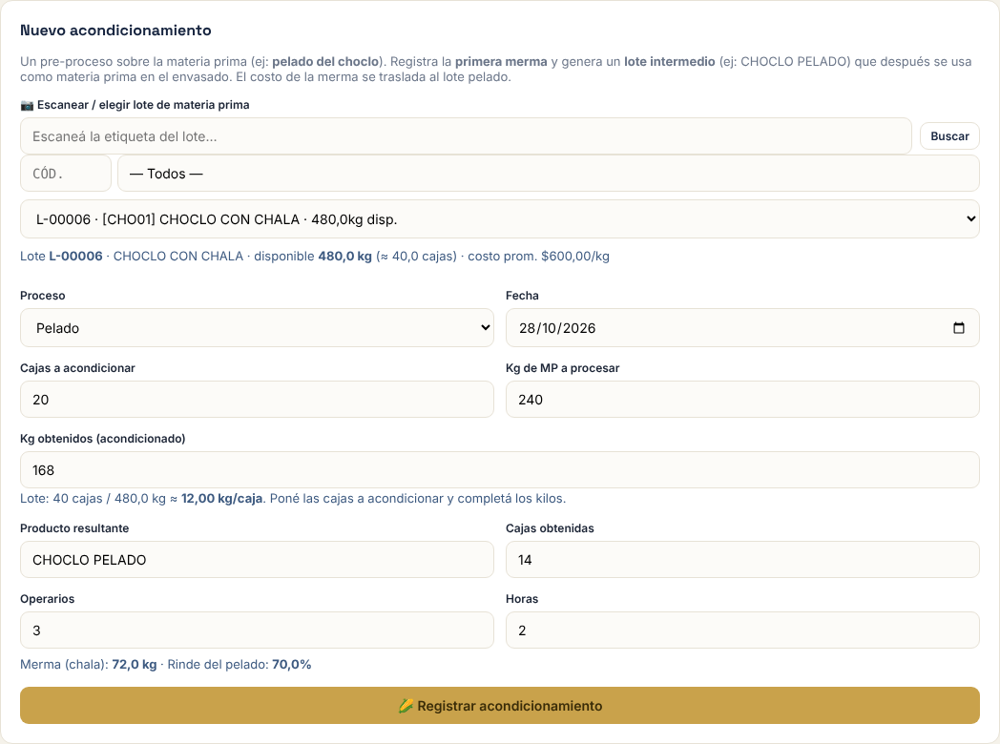

### Registrar un acondicionamiento
1. Escaneá la etiqueta del lote en **📷 Escanear / elegir lote**, o filtrá por MP y elegilo de la lista (aparecen los lotes con stock y sus kilos disponibles).
2. Elegí el **Proceso**: Pelado, Lavado, Corte o Desgranado.
3. Indicá las **Cajas a acondicionar** (los kilos se calculan solos) o escribí directamente los **Kg de MP a procesar**.
4. Cargá los **Kg obtenidos** después del proceso. El sistema muestra la merma y el rinde.
5. Revisá el **Producto resultante** (viene sugerido, por ejemplo "CHOCLO PELADO") y las **Cajas obtenidas**.
6. Opcional: **Operarios** y **Horas**.
7. Tocá **🌽 Registrar acondicionamiento**.

Se genera el código `AC-…` y un lote intermedio con el mismo número del lote original más un sufijo (por ejemplo, `L-00006·1`). Se abre su etiqueta para imprimir.

> 💡 Si volvés a acondicionar el mismo lote de MP para el mismo producto resultante, los kilos se suman al lote intermedio que ya existe.

> ⚠️ Los kilos obtenidos no pueden ser más que los procesados, ni podés procesar más de lo que hay en el lote.

### Editar y anular
- **✎ Editar** (con PIN): fecha, proceso, kilos de entrada y salida, cajas, operarios y horas. Al cambiar los kilos de salida se ajusta el stock del lote intermedio.
- **✕ Anular** (con PIN): libera el stock del lote original. No se puede anular si el lote intermedio ya se usó en una producción: primero anulá esa producción.

## Producción
<!-- id: produccion | grupo: Operaciones | pantalla: prod | roles: admin, supervisor, preparador | resumen: Abrir, completar, validar y anular producciones -->
Una producción transforma la MP de un lote en productos terminados. Tiene dos momentos: se **abre** cuando se empieza (con la MP que se va a usar) y se **valida** cuando se termina (con lo que salió de verdad).

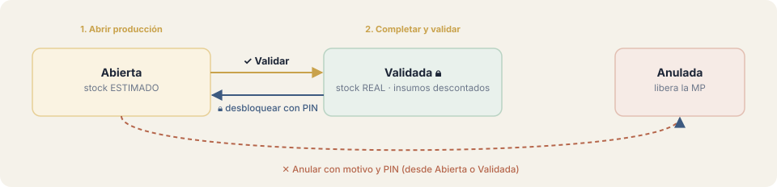

> ⚠️ El stock de producto terminado se suma **recién cuando validás** la producción. Mientras está abierta, lo producido se ve como *estimado* (sirve para adelantar etiquetas, pero no para remitos).

### Abrir una producción simple
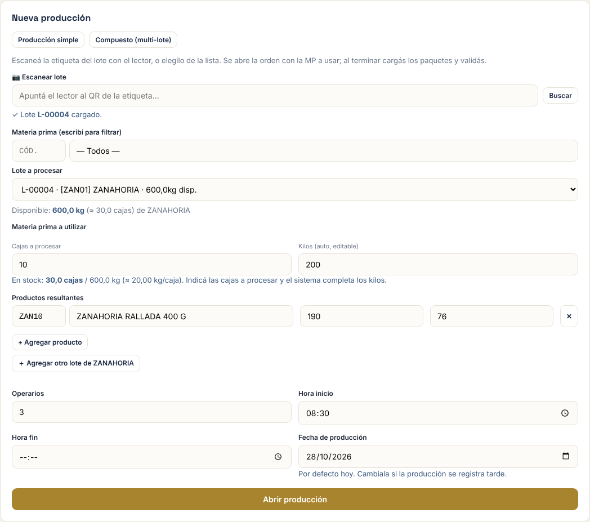

1. Tocá **Producción simple** (viene elegido).
2. Escaneá la etiqueta del lote en **📷 Escanear lote**, o filtrá por MP y elegí el **Lote a procesar**. Los lotes aparecen del más viejo al más nuevo, con los kilos disponibles.
3. Indicá las **Cajas a procesar** (o *Unidades a procesar* si el lote se recibió por unidad). Los **Kilos** se completan solos y los podés corregir.
4. En **Productos resultantes**, elegí el producto, la cantidad de **paquetes** y revisá los **kg** (se calculan con el contenido del producto). Arriba de la lista aparecen los productos que usan esa MP.
5. Si sale más de un producto del mismo lote, tocá **+ Agregar producto**.
6. Cargá **Operarios**, **Hora inicio** y, si ya terminó, **Hora fin**.
7. Revisá la **Fecha de producción**: por defecto es hoy. Cambiala solo si estás cargando una producción atrasada (no puede ser posterior a hoy ni anterior a la recepción del lote).
8. Tocá **Abrir producción**.

Aparece "Producción P-… abierta" y la producción queda en la lista como *Abierta*.

> 🔒 **PEPS**: si existe un lote más viejo de la misma MP con stock, el sistema lo avisa. Lo recomendado es procesar primero el más viejo. Para usar el elegido igual, el supervisor autoriza con su PIN.

### Si el lote no alcanza: varios lotes
1. Con el primer lote cargado, tocá **＋ Agregar otro lote de …**.
2. Elegí el otro lote y sus cajas o kilos.
3. En **Producido con este lote**, cargá cuánto salió de cada producto con ese lote.
4. Abajo ves el total con todos los lotes. Tocá **Abrir producción**.

Se guarda **una producción por lote**, vinculadas entre sí, así cada caja queda con el lote real del que salió.

### Completar y validar
1. En la lista **Órdenes de producción**, seleccioná la producción y tocá **✎ Editar** ("Completar P-…").
2. Ajustá la MP utilizada, los paquetes y kilos reales de cada producto, operarios, horas y fecha. Tocá **Guardar**.
3. Tocá **✓ Validar** y confirmá con **✓ Validar y bloquear**.

Al validar, la producción queda **bloqueada** 🔒, el producto pasa al stock real y se descuentan los insumos de producción. Para corregirla después, el supervisor la desbloquea con PIN (vuelve a *Abierta*, se reponen los insumos y se abre para editar).

> ⚠️ No dejes producciones abiertas de un día para el otro. Las que llevan más de 24 horas se marcan en rojo y aparecen en el Panel.

### Producto compuesto (varias MP)
Para productos que llevan más de una MP (por ejemplo, una ensalada mix):
1. Tocá **Compuesto (multi-lote)** y elegí el producto compuesto.
2. Poné los **Paquetes a producir (estimado)**.
3. Para cada componente, elegí el lote y los **kilos reales a procesar**. **↻ Sugerir PEPS** propone los kilos según la receta, empezando por los lotes más viejos. Con **+ Otro lote** sumás otro lote del mismo componente.
4. Completá operarios, horario y fecha, y tocá **Abrir producción**.
5. Al terminar, completá los paquetes reales con **✎ Editar** y validá.

La diferencia entre los kilos procesados y los kilos de los paquetes queda como merma. Si el producto no tiene receta cargada, el sistema lo avisa: la receta se carga en la ficha del producto, en CONTROL PLUS → Inventario → Productos.

### Ver el detalle
**🔍** muestra la MP consumida por lote, los productos obtenidos, la **merma** en kilos y en porcentaje, el **rendimiento** y la mano de obra (horas-hombre y paquetes por hora-hombre).

### Anular una producción
Seleccioná la producción y tocá **✕ Anular**. Escribí el motivo e ingresá el PIN. Se libera la MP, desaparecen del stock los productos generados y se restituyen los insumos.

### Buscar y exportar
- Filtrá la lista por **Producto** o por **Lote / OP** (se puede escanear).
- **🖨️ Reporte / exportar** muestra la producción del período: un total por producto y el detalle por lote. Las reventas no se cuentan como producción.

## Órdenes de producción (desde pedidos)
<!-- id: ordenes | grupo: Operaciones | pantalla: prod | roles: admin, supervisor, preparador, comercial | resumen: Producir lo que piden los clientes, una orden por materia prima -->
Las órdenes de producción conectan los **pedidos** con la **producción**. Desde Pedidos o desde el Plan se envía lo que hay que producir, y en Producción aparece como **🏭 Órdenes por ejecutar**.

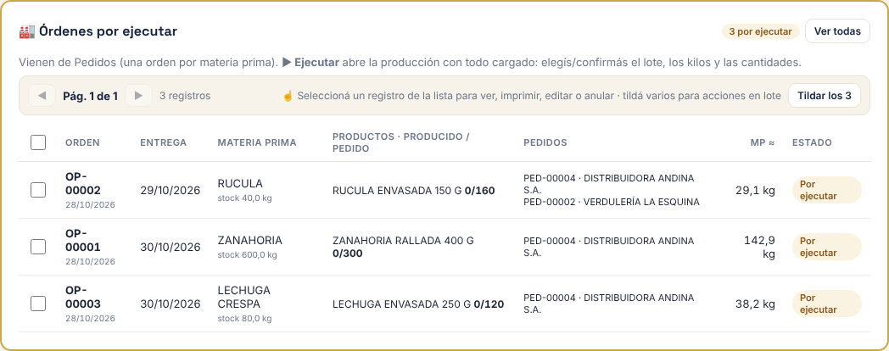

### Cómo se generan
- Desde **Pedidos**: tildá los pedidos pendientes y tocá **🏭 Enviar a producción** (o el botón 🏭 de un pedido). Ver [Pedidos](#pedidos).
- Desde el **Plan de producción**: **🏭 Enviar a producción** manda la columna *Producción* de cada producto. Ver [Plan de producción](#plan).

Se arma **una orden por materia prima**, con todos los productos que salen de ella. Si ya hay una orden pendiente de esa MP, lo nuevo se suma a esa orden. Las órdenes se numeran `OP-00001`, `OP-00002`…

### Ejecutar una orden
1. En Producción, en la tarjeta **🏭 Órdenes por ejecutar**, buscá la orden. Las de entrega más próxima aparecen primero, y si la entrega ya pasó, se marca con ⚠️.
2. Tocá **▶ Ejecutar**. La producción se precarga con la MP, el lote más viejo con stock, los productos y las cantidades que faltan.
3. Revisá el lote, los kilos y las cantidades, y tocá **Abrir producción**. Queda vinculada a la orden.

Si el lote no alcanza, el sistema suma los lotes siguientes (PEPS) y reparte lo producido. Si no hay stock suficiente de esa MP, te avisa cuántos kilos faltan. Para salir sin ejecutar, tocá **Salir de la orden**.

### Estados de una orden
| Estado | Qué significa |
|---|---|
| Por ejecutar | Todavía no tiene producciones |
| En curso | Tiene producciones, pero falta producir |
| Completa | Ya se produjo todo lo pedido |
| Cerrada | Se cerró con faltante (con motivo) |
| Anulada | Se anuló antes de producir |

### Otras acciones
- **🖨️ Imprimir orden**: hoja para la planta con lo que falta producir, la MP estimada, los lotes sugeridos (PEPS), los pedidos que cubre y espacio para anotar el lote, los kilos y el responsable.
- **⏹ Cerrar con faltante**: deja de estar por ejecutar aunque falte producir. Pide el motivo (no hubo MP suficiente, se produjo con otro lote, el cliente redujo o canceló, otro).
- **✕ Anular**: solo si todavía no tiene producciones. Los pedidos vuelven a quedar listos para enviar a producción.
- **Ver todas** muestra también las completas, cerradas y anuladas.

## Ensamblado (packs con productos terminados)
<!-- id: ensamblado | grupo: Operaciones | pantalla: ens | roles: admin, supervisor, preparador | resumen: Armar cajas o packs con productos ya terminados -->
El ensamblado arma un **pack** con productos que ya están terminados (por ejemplo, una caja surtida con varios productos). Cada componente se toma del lote más viejo (PEPS) y queda trazado.

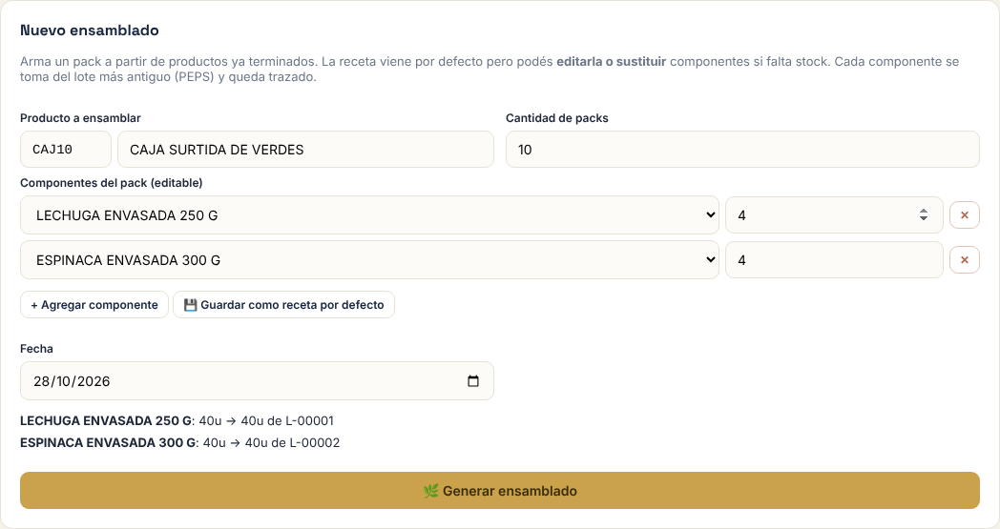

> 💡 Para usar esta pantalla, el producto del pack tiene que estar marcado como *compuesto de ensamblado* en su ficha (CONTROL PLUS → Inventario → Productos), con su receta de componentes.

### Generar un ensamblado
1. Elegí el **Producto a ensamblar**. Se carga su receta por defecto.
2. Poné la **Cantidad de packs** (cajas).
3. Revisá los **Componentes del pack**: producto y cantidad por pack. Podés cambiar un componente, su cantidad, quitarlo (✕) o sumar otro (**+ Agregar componente**). Esto sirve, por ejemplo, para sustituir un producto que se quedó sin stock.
4. Si querés que la receta modificada quede como la nueva receta de siempre, tocá **💾 Guardar como receta por defecto**.
5. Revisá la **Fecha** y el cálculo de cada componente (cuánto hace falta, de qué lotes sale y si falta stock).
6. Tocá **🌿 Generar ensamblado**.

Se genera el código `E-…`. Los componentes se descuentan del stock y el pack se suma al stock en **paquetes** (cajas × suma de la receta).

> ⚠️ Si no alcanza el stock de un componente, el sistema avisa "No alcanza el stock de… (faltan N u). Sustituí ese componente."

### Ver, editar y anular
- **🔍 Ver**: total en paquetes, cajas, paquetes por caja y componentes con su lote.
- **✎ Editar** (con PIN): cambiá la cantidad de cajas o la receta por caja. Se recalculan el stock, los componentes y los insumos.
- **✕ Anular** (con motivo y PIN): el pack sale del stock, los componentes vuelven y se reponen los insumos.

## Descarte
<!-- id: descarte | grupo: Operaciones | pantalla: descmp | roles: admin, supervisor, preparador | resumen: Registrar MP o producto envasado que se pierde -->
Cuando algo se pierde (vencido, dañado, cadena de frío cortada), se registra acá para que baje del stock y quede como pérdida.

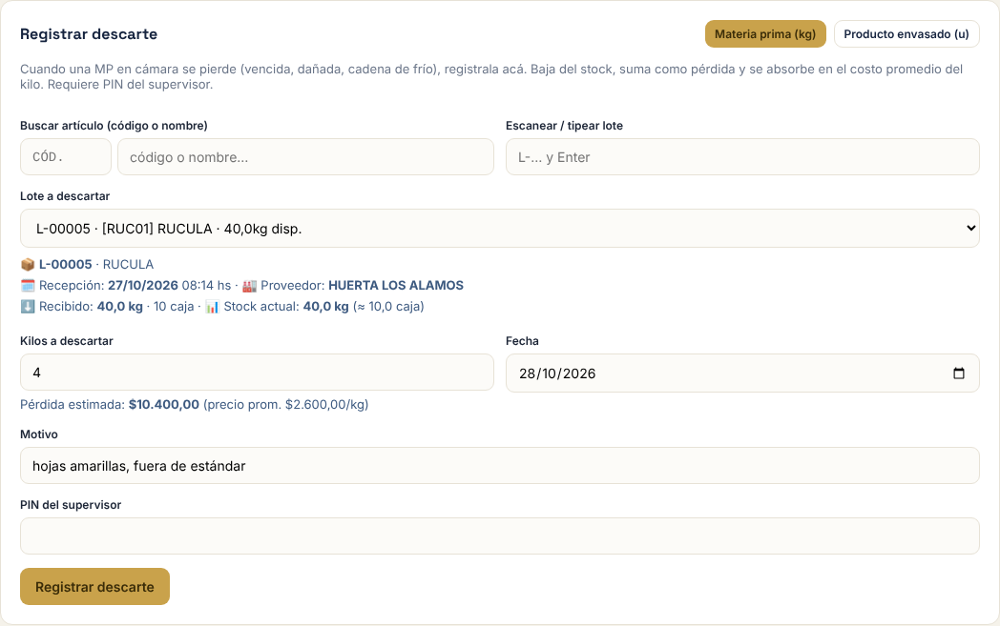

Arriba ves la **💸 Pérdida por descarte de MP** (en pesos) y la cantidad de descartes registrados.

### Descartar materia prima (kg)
1. Elegí **Materia prima (kg)**.
2. Buscá el artículo o escaneá el lote. Elegí el **Lote a descartar** y revisá su información (proveedor, fecha de recepción y stock actual).
3. Poné los **Kilos a descartar** y la **Fecha**. El sistema muestra cuánto representa la pérdida.
4. Escribí el **Motivo** e ingresá el **PIN del supervisor**.
5. Tocá **Registrar descarte**.

La pérdida se absorbe en el costo promedio del kilo de esa MP.

### Descartar producto envasado (unidades)
1. Elegí **Producto envasado (u)**.
2. Buscá el producto o escaneá el lote, y elegí el **Lote de producto a descartar**.
3. Poné las **Unidades (paquetes)**, la **Fecha**, el **Motivo** y el **PIN**.
4. Tocá **Registrar descarte de producto**.

### Corregir un descarte
- **✎ Editar** (con PIN): fecha, kilos y motivo.
- **✕ Anular** (con PIN): los kilos vuelven al stock del lote.

## Devoluciones
<!-- id: devoluciones | grupo: Operaciones | pantalla: dev | roles: admin, supervisor, comercial | resumen: Lo que devuelve el cliente y su destino -->
Registra lo que devuelve un cliente y qué se hace con eso.

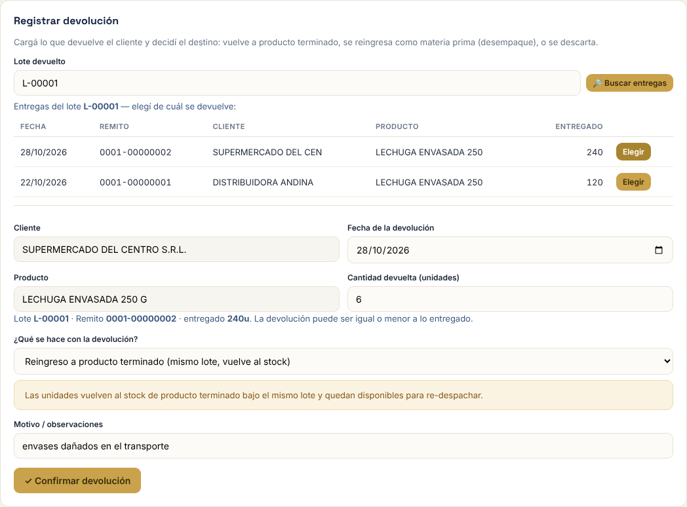

### Registrar una devolución
1. En **Lote devuelto**, escaneá o escribí el lote del producto y apretá Enter (o **🔎 Buscar entregas**).
2. Aparecen las **entregas (remitos) de ese lote**: fecha, remito, cliente, producto y cantidad entregada. Tocá **Elegir** en la que corresponde.
3. El cliente y el producto se completan solos. Revisá la **Fecha** y la **Cantidad devuelta** (viene con lo entregado, y no puede ser mayor).
4. Elegí **¿Qué se hace con la devolución?**:
   - **Reingreso a producto terminado**: las unidades vuelven al stock con el mismo lote y se pueden volver a entregar.
   - **Reingreso como materia prima**: el producto se desempaca y vuelve a cámara como MP. Elegí la MP y los kilos. Se crea un lote nuevo de reingreso. Los insumos (envases, etiquetas) no se recuperan.
   - **Descarte total**: no vuelve al stock. Queda registrado para respaldo y nota de crédito.
5. Escribí el **Motivo / observaciones** y tocá **✓ Confirmar devolución**.

Se genera el código `DEV-…`.

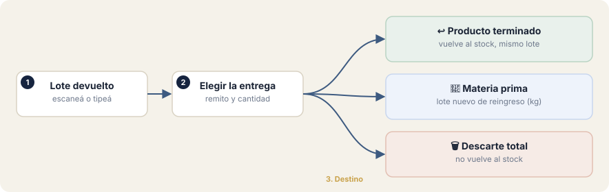

> ⚠️ Si no aparecen entregas para el lote, revisá el código o si el remito está anulado.

### Editar y anular
- **✎ Editar** (con PIN): si fue a stock o a descarte, podés repartir las unidades entre las que vuelven a stock y las que se descartan. Si fue a MP, podés corregir la fecha, la cantidad, los kilos y el motivo. Para cambiar el destino de una devolución a MP, anulala y registrala de nuevo.
- **✕ Anular** (con PIN): revierte el efecto en el stock según el destino.

## Validación de carga
<!-- id: carga | grupo: Operaciones | pantalla: carga | roles: admin, supervisor, chofer | resumen: Controlar las cajas antes de que salga el camión -->
Antes de que salga el camión, se controla que lo cargado coincida con el remito. Es el paso que habilita la entrega.

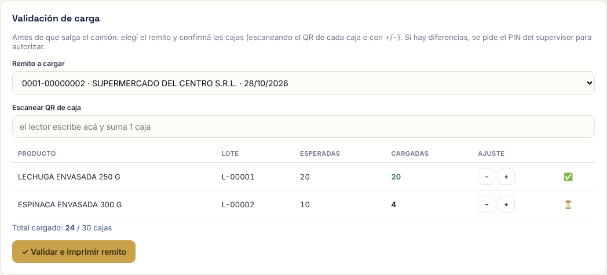

### Validar una carga
1. En **Remito a cargar**, elegí el remito. Aparecen los remitos emitidos que todavía no se validaron.
2. Escaneá el **QR de cada caja** en **Escanear QR de caja**: cada lectura suma una caja al producto que corresponde. También podés sumar o restar con **+** y **−**.
3. Mirá la tabla: cajas **Esperadas** y **Cargadas** por producto, con ✅ cuando coincide, ⏳ si falta y ⚠️ si sobra. Abajo ves el total cargado.
4. Tocá **✓ Validar e imprimir remito**. Se abre el remito para imprimir y entregar con la mercadería.

> 🔒 Si hay diferencias, o se escaneó una caja de otro remito, el sistema pide el **PIN del supervisor** y una **nota** con el motivo (por ejemplo: "faltó 1 caja, se despacha igual"). La carga queda marcada *Con diferencias*.

### Cargas validadas
Abajo está la lista de cargas validadas, con la fecha, quién la hizo y si fue *OK* o *Con diferencias*. En Remitos, ese remito pasa a mostrar **Carga validada**.

## Pedidos
<!-- id: pedidos | grupo: Administración | pantalla: ped | roles: admin, supervisor, comercial | resumen: Cargar pedidos, leer órdenes de compra con IA, confirmar y enviar a producción -->
Los pedidos de los clientes se cargan en **unidades (paquetes)**. A partir de ellos se planifica la producción y se arman los remitos.

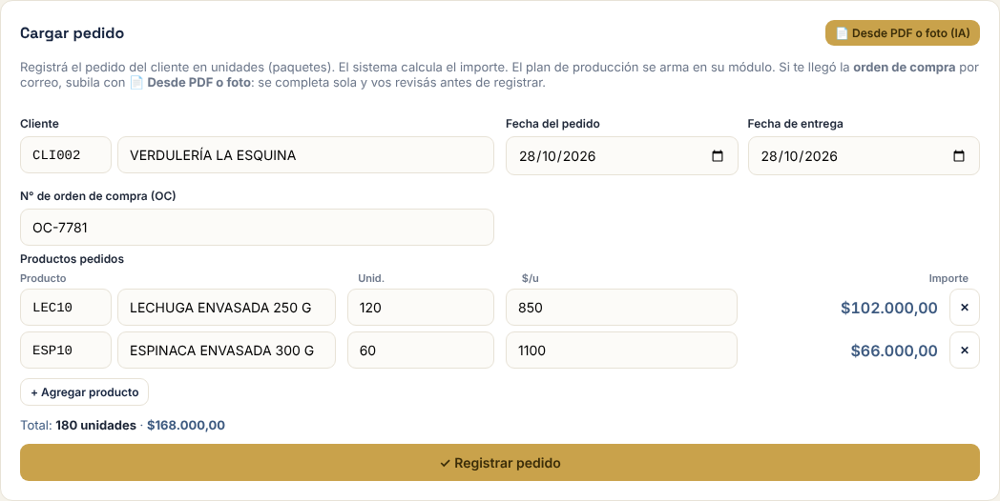

### Cargar un pedido a mano
1. Elegí el **Cliente**. Los precios se completan con el último precio de ese cliente.
2. Revisá la **Fecha del pedido** y la **Fecha de entrega**.
3. Si el cliente mandó orden de compra, poné el **N° de OC**: después pasa al remito.
4. En **Productos pedidos**, por cada renglón elegí el producto, las **Unid.** y el **$/u**. El **Importe** se calcula solo. Con **+ Agregar producto** sumás renglones (o apretá Enter en el precio).
5. Abajo ves el total de unidades y de pesos. Tocá **✓ Registrar pedido**.

Se genera el número `PED-…` y el pedido queda **Pendiente**.

### Cargar un pedido desde la orden de compra (IA)
Si la orden de compra del cliente llegó en PDF o en foto:
1. Tocá **📄 Desde PDF o foto (IA)** y elegí el archivo (PDF, JPG o PNG, hasta 15 MB).
2. Esperá unos segundos ("Leyendo…"). El formulario se completa con el cliente, las fechas, la OC, los productos, las cantidades y los precios.
3. Revisá la tarjeta **📄 Leído de…**: muestra la confianza de la lectura (🟢 alta, 🟡 media, 🔴 baja), cada renglón de la OC con el producto que se le asignó y los avisos.
4. Corregí lo que haga falta. Los renglones que no se pudieron asociar a un producto quedan **en amarillo**: elegí el producto a mano.
5. Tocá **✓ Registrar pedido**. La orden de compra queda guardada con el pedido (en el detalle: **📎 Ver orden de compra**).

> ⚠️ Revisá siempre antes de registrar. El sistema avisa si no encontró al cliente, si la OC no tiene fecha de entrega, si ya existe un pedido con esa misma OC (posible duplicado), si los precios parecen incluir IVA o si las cantidades vienen en cajas o en kilos.

> 💡 Si la foto es de iPhone en formato HEIC, mandala en JPG o subí un PDF.

### Pedidos de la app de vendedores
Los pedidos que cargan los vendedores desde el celular (CONTROL VENDEDOR) entran como **📱 Por confirmar**. Arriba de la lista aparece el botón **📱 N por confirmar**.
1. Tocá **✓** en el pedido (o seleccioná varios y tocá **✓ Confirmar pedidos**).
2. Revisá los datos. Con **Editar primero** podés corregirlo, por ejemplo para completar los precios que faltan.
3. Tocá **✓ Confirmar**. El pedido recibe su número `PED-…` y pasa a **Pendiente**.

> ⚠️ Si el vendedor dio de alta un **cliente nuevo** (🆕), completá sus datos (CUIT, condición de IVA, dirección) en CONTROL PLUS → Entidades antes de facturar.

### Estados de un pedido
| Estado | Qué significa |
|---|---|
| 📱 Por confirmar | Lo cargó un vendedor desde la app. Falta revisarlo |
| Pendiente | Confirmado y todavía no entregado. Entra en el plan y en remitos |
| Entregado | Se emitió el remito (se ve su número) o se marcó a mano |
| No entregado | No se despachó. Se guarda el motivo |

### Acciones de cada pedido
- **🔍 Ver**: el detalle, con el stock disponible de cada producto ("faltan N" o "en stock").
- **✎ Editar**: cliente, fechas, OC y productos.
- **⧉ Copiar**: crea un pedido nuevo con los mismos productos, cantidades y precios, con fecha de hoy. Ajustalo y registralo.
- **🏭 Enviar a producción**: ver más abajo.
- **📄 Emitir remito**: abre Remitos con el pedido cargado. Al emitir el remito, el pedido pasa a *Entregado*.
- **✓ Marcar entregado**: si se entregó sin remito del sistema.
- **🚫 No se entregó**: pide el motivo (sin stock, lo canceló el cliente, problema de transporte, calidad, feriado o cliente cerrado, otro) y un detalle opcional. El pedido deja de figurar como pendiente, pero sigue contando en el reporte de cumplimiento.
- **↺ Volver a pendiente**: reabre un pedido entregado o no entregado.
- **✕ Eliminar**: borra el pedido. **No se puede deshacer**: si el pedido no se va a entregar, preferí **🚫 No se entregó**, así queda registrado.

### Enviar a producción
1. Tildá uno o varios pedidos **pendientes** y tocá **🏭 Enviar a producción**.
2. Revisá la vista previa: una orden por materia prima, con lo pedido, el stock de producto terminado, lo que hay que producir y la MP estimada.
3. La casilla **Descontar el stock de producto terminado** viene tildada: se produce solo lo que falta. Destildala para mandar lo pedido completo.
4. Tocá **🏭 Enviar la orden**.

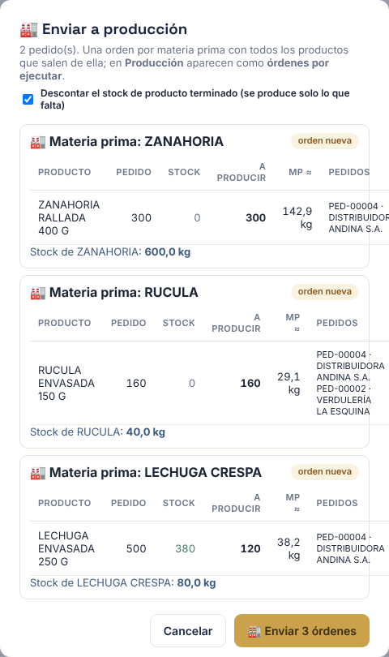

> 💡 No se envían los productos que ya están en una orden, los que se arman en Ensamblado ni los que no tienen MP cargada en su ficha. La vista previa los lista con el motivo.

### Filtrar la lista
Filtrá por período, **Cliente**, **Producto** y **Estado**. Al lado ves cuántos pedidos cumplen el filtro.

## Plan de producción
<!-- id: plan | grupo: Administración | pantalla: plan | roles: admin, supervisor, comercial, preparador | resumen: Qué producir para una entrega y qué MP comprar -->
El plan responde dos preguntas para una fecha de entrega: **qué hay que producir** y **qué materia prima hay que comprar**.

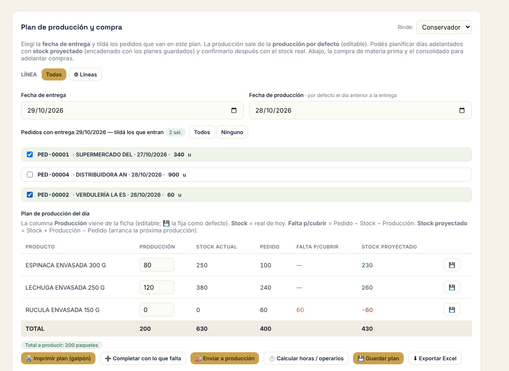

### Armar el plan
1. Elegí la **Fecha de entrega** (por defecto, mañana). La **Fecha de producción** se pone sola el día anterior. Podés cambiarla y volver con ↺.
2. En **Pedidos con entrega…**, tildá los pedidos que entran en este plan. Aparecen todos los pedidos pendientes, con el número, el cliente, la fecha del pedido y las unidades. Con **Todos** y **Ninguno** tildás o destildás todos.
3. Revisá la tabla **Plan de producción del día**:
   - **Producción**: cuánto producir. Viene de la *producción por defecto* de cada producto y la podés cambiar. Con 💾 guardás ese número como el nuevo valor por defecto del producto.
   - **Stock**: stock actual de producto terminado (o el proyectado, ver abajo).
   - **Pedido**: lo pedido en los pedidos tildados.
   - **Falta p/cubrir** = Pedido − Stock − Producción. Si aparece un número, ni produciendo eso alcanzás.
   - **Stock proyectado** = Stock + Producción − Pedido. Es lo que queda para el día siguiente (en rojo si es negativo).
4. **➕ Completar con lo que falta** pone en *Producción* lo pedido menos el stock de cada producto.
5. Elegí el **Rinde** que se usa para calcular la MP: *Conservador* (el menor entre el teórico y el real), *Teórico* o *Real prom.*

### Planificar varios días: stock proyectado
Si ya guardaste planes de fechas anteriores, aparece la casilla **Usar stock proyectado**. El stock de cada producto se calcula encadenando esos planes (stock de hoy + lo que se va a producir − lo que se va a entregar antes de esta fecha).

Cuando llega el día, en **Planes guardados** tocá **✅ Confirmar con stock real**: el plan se recalcula con el stock real y pasa de *Proyectado* a *Confirmado*.

### Líneas de producción y capacidad
Si la empresa trabaja con líneas:
1. Con **⚙ Líneas** creás las líneas (nombre, operarios, horas del turno y productividad en paquetes por hora-hombre) y asignás la línea de cada producto. Si dejás la productividad vacía, se usa la real de esa línea.
2. Elegí una línea en los botones de arriba para ver solo sus productos y su **⏱️ Capacidad**: horas-hombre necesarias y si **✅ Alcanza** o **⚠️ No alcanza** (cuántas horas faltan y cuántos operarios harían falta).
3. Con **Todas**, la tabla **Carga por línea** muestra el estado de cada línea.

**⏱️ Calcular horas / operarios** es una calculadora rápida: paquetes, operarios y productividad.

### Materia prima a comprar
- **Materia prima a comprar — este plan**: lo requerido según el rinde, el stock y lo que hay que **Comprar** (editable).
- **Compras a adelantar**: suma la MP de este plan y de los planes guardados con entrega anterior, contra el stock real de hoy.
- **+ Agregar insumo** suma un renglón a mano, **📋 Copiar lista** copia la lista para mandarla por mensaje o correo, y **🖨️ Imprimir / PDF** imprime la lista de compra.

### Guardar, imprimir y enviar
- **🖨️ Imprimir plan (galpón)**: la hoja para la planta, solo con los productos que tienen producción mayor a 0.
- **🏭 Enviar a producción**: arma las órdenes de producción con la columna *Producción*, una por MP (descuenta lo que ya está en órdenes por ejecutar). Ver [Órdenes de producción](#ordenes).
- **💾 Guardar plan**: queda en **Planes guardados** con número `PLAN-…`. Desde ahí podés verlo (🔍), editarlo (✎), confirmarlo (✅), exportarlo (⬇) o eliminarlo (✕). Eliminar un plan no afecta a los pedidos ni a la producción.
- **⬇ Exportar Excel**: descarga el plan y la compra.

## Remitos
<!-- id: remitos | grupo: Administración | pantalla: ent | roles: admin, supervisor, comercial | resumen: Armar la entrega, asignar lotes, imprimir, editar y anular -->
El remito registra lo que se entrega a cada cliente y **de qué lote sale cada producto**. Al asignar el lote, se descuenta el stock.

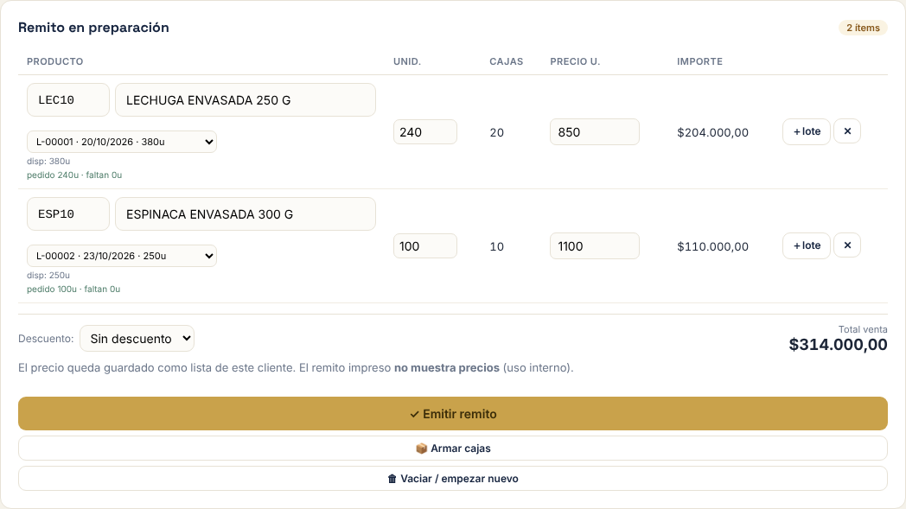

### El recorrido de una entrega
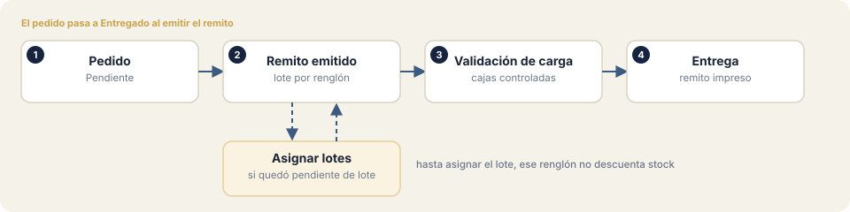

### Armar un remito desde un pedido
1. Arriba, en **Pedidos pendientes de entregar**, buscá el pedido (están ordenados por fecha de entrega, y ⚠️ marca los vencidos). Tocá **📄 Armar remito**.
   También podés elegir el cliente y usar **Cargar desde pedido**, o tocar 📄 en Pedidos.
2. Se cargan los productos y las cantidades del pedido. En cada renglón, elegí el **lote** en "— elegí lote (PEPS) —". Aparecen los lotes con stock, del más viejo al más nuevo, con las unidades disponibles.
3. Si un lote no alcanza, tocá **＋lote**: se agrega otro renglón del mismo producto con lo que falta para completar el pedido. Elegí ahí el otro lote.
4. Revisá las **Unid.** (en rojo si superan lo disponible del lote), las **Cajas** (se calculan con las unidades por caja) y el **Precio u.**
5. Si corresponde, aplicá un **Descuento** (porcentaje o monto fijo).
6. Tocá **✓ Emitir remito**.

El número sale del punto de venta de la empresa más un correlativo (por ejemplo `0001-00000124`). El pedido pasa a *Entregado*.

> ⚠️ El remito se imprime al **validar la carga** (pantalla Validación de carga). El chofer no puede entregar sin ese paso.

### Remito sin pedido
Elegí el **Cliente** y la **Fecha de entrega**, poné la **Orden de compra** si hay, y agregá productos con **+ Agregar producto**. Después seguí desde el paso 2.

### Emitir sin lote (y asignarlo después)
Si todavía no está validada la producción de un producto, podés emitir el remito sin elegir el lote: el renglón queda en amarillo, *pendiente de lote*.
- Una línea sin lote **no descuenta stock** hasta que se le asigna.
- En la lista aparece **🏷️ Asignar lotes (N)**. Tocalo, repartí cada producto en uno o varios lotes con su cantidad, y tocá **Asignar**. Si asignás menos del total, el resto sigue pendiente.
- Si un lote queda con stock negativo (porque la producción todavía no se validó), el sistema pide el PIN del supervisor.

> 💡 Asigná los lotes pendientes lo antes posible: hasta que no se asignan, el stock no cuadra.

### Precios
El precio se sugiere con el último precio del cliente para ese producto, o con el del pedido. Al emitir, queda guardado como precio de lista de ese cliente. El remito impreso **no muestra precios**: es un documento interno para acompañar la mercadería.

### Armar cajas con varios productos
Cuando el cliente recibe cajas con productos mezclados:
1. Con el remito cargado, tocá **📦 Armar cajas**.
2. Agregá cajas (**+ Agregar caja**) y, en cada una, los productos con su cantidad (**+ Ítem**).
3. Arriba ves si el reparto **✓ coincide con el remito** o qué falta.
4. Tocá **Guardar cajas** o **Guardar e imprimir**. Se imprime una etiqueta por caja con su contenido, "Caja N de M" y un QR.

En el remito impreso, los bultos pasan a ser la cantidad de cajas armadas. Las etiquetas se reimprimen con 📦 en la lista de remitos.

### Remito de muestra
- Para una muestra sin valor comercial, tildá **🎁 Muestra sin valor comercial**: precio 0, descuenta stock y no afecta las ventas ni la lista de precios.
- Desde un remito emitido, **🎁** arma una muestra con el mismo cliente, fecha y OC, y la cantidad de muestra de cada producto (editable). Revisá, elegí los lotes y emití.

### Imprimir, editar, anular y reactivar
- **🖨️ Imprimir remito**: hoja A4, con la opción **Imprimir un duplicado**. Para varios, tildalos y usá **🖨️ Imprimir remitos** (uno por hoja).
- **🔍 Ver**: el detalle con el lote de cada renglón, las cajas armadas y los importes bruto, descuento y neto.
- **✎ Editar** (con PIN): vuelve a la pantalla con el remito cargado para cambiar lotes, productos o cantidades. Tocá **💾 Guardar cambios**.
- **✕ Anular** (con PIN): el remito queda anulado (no se borra), los lotes vuelven a estar disponibles y, si venía de un pedido, el pedido vuelve a *Pendiente*.
- **♻️ Reactivar** (con PIN): vuelve a activar un remito anulado y descuenta de nuevo el stock. Solo se puede si hay stock suficiente.

> 💡 En Chrome, al imprimir, desmarcá **Encabezados y pies de página** para que no salgan la fecha y la dirección de la página.

## Etiquetas
<!-- id: etiquetas | grupo: Administración | pantalla: desp | roles: admin, supervisor, preparador | resumen: Imprimir etiquetas de paquete y caja, diseños y asignación por producto -->
La pantalla tiene tres pestañas: **🖨️ Impresión**, **🎨 Diseños** y **🔗 Asignación por producto**.

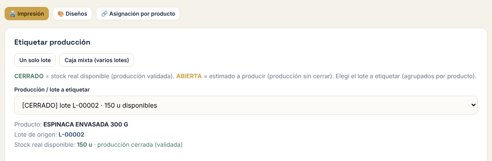

### Imprimir etiquetas de un lote
1. En **🖨️ Impresión**, dejá elegido **Un solo lote**.
2. En **Producción / lote a etiquetar**, elegí el lote. Están agrupados por producto:
   - **CERRADO**: stock real de una producción validada.
   - **ABIERTA**: estimado de una producción que todavía no se cerró. Sirve para adelantar etiquetas.
3. Revisá la **Fecha de envasado**, el **Formato**, la **Cantidad a etiquetar**, las **Unidades por caja** y la **Vida útil** (el **Vencimiento** se calcula solo).
4. Si el producto lleva insumos de despacho (por ejemplo, pallets), ajustá la cantidad real.
5. Tocá **🏷️ Generar etiquetas (paquete + caja)**.

Se abre la ventana de impresión con las etiquetas de paquete y de caja:
- En **¿Cuántas imprimir?** podés cambiar la cantidad de cada tipo y tocar **Aplicar** (útil si la impresora falló).
- **MUESTRA** agrega la leyenda de muestra sin valor comercial.
- Si el producto tiene un diseño guardado, se muestran los ajustes de impresión (tamaño de papel, orientación y cola de impresora), y los botones **🖨️ Paquetes (rollo)** y **🖨️ Cajas (rollo)**.

> 💡 En el cuadro de impresión de Chrome elegí como **Destino** la impresora indicada, **Márgenes**: Ninguno, **Escala**: predeterminada (100 %) y desmarcá **Encabezados y pies de página**.

> ⚠️ Si la cantidad supera el stock real, el sistema lo avisa, pero imprime igual.

### Caja con varios lotes (caja mixta)
Cuando una caja se completa con unidades de más de un lote:
1. Tocá **Caja mixta (varios lotes)** y elegí el producto.
2. Indicá cuántas unidades tomás de cada lote (los más viejos primero).
3. Completá la fecha, las unidades por caja y la vida útil, y tocá **🏷️ Generar etiquetas (caja mixta)**.

Se genera **una sola etiqueta de caja** con un QR que lleva a todos los lotes, y cada paquete lleva su propio lote.

### Etiquetas generadas
La lista muestra cada etiquetado (`D-…`) con su producto, lote y unidades:
- **🏷️** reimprime.
- **✎ Editar** (con PIN) corrige lotes, cantidades, fecha y vencimiento.
- **✕ Anular** (con motivo y PIN) devuelve el producto al stock y repone los insumos. No se puede si ya está en un remito: primero anulá ese remito. Si ya imprimiste etiquetas de ese despacho, descartalas físicamente.

### Diseñar etiquetas
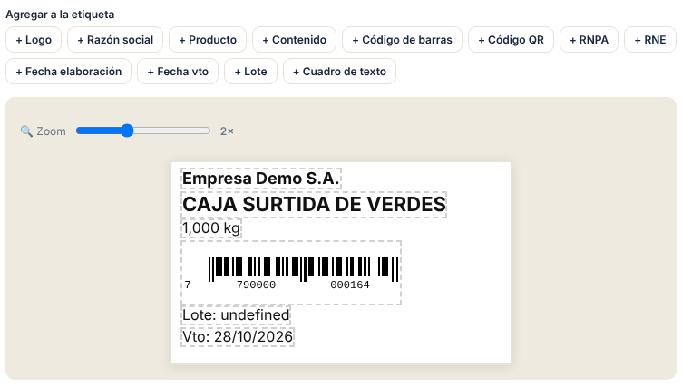

En **🎨 Diseños** está la biblioteca de diseños, por tipo: **paquete**, **caja**, **lote / materia prima** (la etiqueta de recepción) y **caja armada** (la de las cajas armadas en el remito).
1. Tocá **+ Nuevo de…** del tipo que necesites, o elegí un diseño para editarlo.
2. Definí el **Ancho** y el **Alto** en milímetros, las **etiquetas por fila** del rollo (1 a 3), las separaciones y, si el rollo va en columnas, **Rotar 90°**.
3. En **Impresora / cola de Windows**, escribí el nombre exacto de la impresora instalada para ese tipo de etiqueta.
4. Con **Agregar a la etiqueta** sumá campos: logo, razón social, producto, contenido, código de barras, QR, RNPA, RNE, RENSPA, fechas, lote, proveedor, peso, texto libre, etc.
5. Arrastrá cada elemento a su lugar. A la derecha ajustás el tamaño de letra, la negrita, la alineación y las medidas.
6. Tocá **💾 Guardar biblioteca**.

Con **★ Por defecto** marcás el diseño que se usa cuando un producto no tiene uno asignado. También podés **✎ Renombrar**, **⧉ Duplicar** o **🗑 Borrar** (siempre queda al menos uno de cada tipo).

> 💡 Para **etiquetas preimpresas** (que ya traen la imagen del producto), creá un diseño que tenga solo los datos variables: lote, fechas y código.

### Asignar un diseño a cada producto
En **🔗 Asignación por producto**, elegí qué diseño de paquete y de caja usa cada producto. Si no elegís ninguno, sale el diseño por defecto. Se guarda al cambiar.

## Trazabilidad
<!-- id: trazabilidad | grupo: Análisis | pantalla: traz | roles: admin, supervisor, comercial, preparador | resumen: La historia completa de un lote, producción o remito -->
Con cualquier código, reconstruís toda la cadena: de qué proveedor vino, cómo se procesó y a qué clientes se entregó.

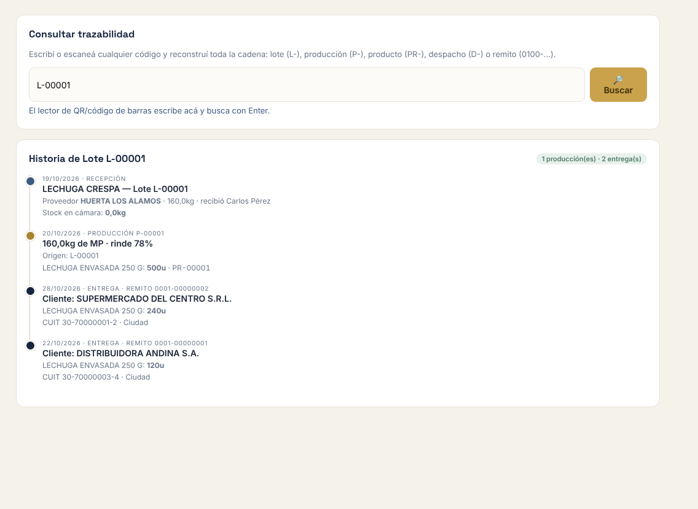

### Consultar
1. Escribí o escaneá el código en **Consultar trazabilidad**: lote (`L-`), producción (`P-`), ensamblado (`E-`), producto (`PR-`), despacho (`D-`) o número de remito.
2. Apretá Enter o tocá **🔎 Buscar**.

Aparece la **Historia** del lote como una línea de tiempo:
- **Recepción**: proveedor, kilos, quién la recibió y stock que queda en cámara.
- **Acondicionamiento**: kilos de entrada y de salida, merma y lote intermedio.
- **Descarte de MP**, si lo hubo.
- **Producción** o **Ensamblado**: kilos de MP, rinde, origen y productos obtenidos.
- **Entrega**: remito, cliente y cantidades.
- **Devolución**, si la hubo.

Si buscás un **remito**, ves el cliente, los lotes entregados y el remito. Para ver la cadena hacia atrás, consultá uno de esos lotes.

> 💡 Un **recall** (retiro de producto) se resuelve acá: con el lote de MP ves todas las producciones y todos los clientes que recibieron producto de ese lote.

> 💡 Los ajustes de stock no aparecen en la trazabilidad, porque son correcciones de inventario y no movimientos físicos del lote. Para ver todos los movimientos de un artículo, usá el reporte **Movimientos de stock** en CONTROL TOTAL.

## Stock
<!-- id: stock | grupo: Análisis | pantalla: stock | roles: admin, supervisor, comercial, preparador | resumen: Stock de MP y de productos por lote, planilla de conteo y Excel -->
Muestra el stock de materia prima y de producto terminado, por artículo y por lote.

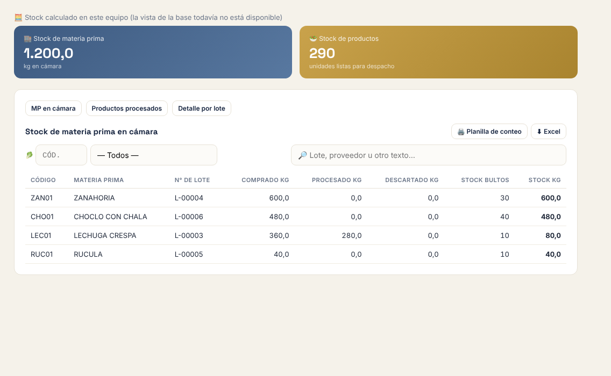

Arriba se indica de dónde sale el cálculo. **🔗 Stock calculado por la base de datos** significa que es el mismo dato que usa CONTROL PLUS, y podés tocar *verificar*. **🧮 Stock calculado en este equipo** es un cálculo de respaldo.

### Pestañas
- **MP en cámara**: por materia prima, con los kilos comprados, procesados y descartados, el stock en bultos y en kilos, y los lotes con stock.
- **Productos procesados**: por producto y por lote, solo de producciones validadas, con subtotales y total general.
- **Detalle por lote**: cada lote de MP con su stock, del más viejo al más nuevo (para controlar el PEPS).

### Buscar, contar y exportar
- Filtrá por artículo (código o nombre) o escribí un texto (lote, proveedor…).
- **🖨️ Planilla de conteo**: imprime en A4 lo que estás viendo (con el filtro aplicado), con dos columnas en blanco para anotar el **conteo físico** y la **diferencia**, y lugar para las firmas de quien contó y de quien controló.
- **⬇ Excel**: descarga la tabla.

> 💡 Si el conteo físico no coincide, la corrección (ajuste de stock) se hace en CONTROL PLUS → Inventario.

## Qué se hace en otros módulos
<!-- id: otros-modulos | grupo: Ayuda | roles: todos | resumen: Catálogo, costos, ajustes, reportes, usuarios y permisos -->
Algunas cosas que usa TRACE se cargan en otros módulos de CONTROL MAX (se trabaja sobre los mismos datos):

| Qué | Dónde |
|---|---|
| Productos, materias primas, recetas, producción por defecto, unidades por caja, vida útil | CONTROL PLUS → Inventario |
| Costos de productos | CONTROL PLUS → Inventario → Costos |
| Ajustes de stock (correcciones de inventario) | CONTROL PLUS → Inventario |
| Cámaras (ubicaciones), envases y traslados entre cámaras | CONTROL PLUS → Inventario |
| Clientes, proveedores y vendedores | CONTROL PLUS → Entidades |
| Reportes (diario, compras, rinde, entregas, cumplimiento, movimientos de stock, auditoría) | CONTROL TOTAL |
| Datos de la empresa, usuarios, roles, permisos, PIN y autorizadores | Configuración CONTROL MAX |
| Pedidos desde el celular de los vendedores | CONTROL VENDEDOR |

## Problemas frecuentes
<!-- id: problemas | grupo: Ayuda | roles: todos | resumen: Mensajes del sistema y qué hacer -->
### "No hay stock" de un producto que ya produje
El stock de producto terminado cuenta solo las producciones **validadas**. Andá a Producción, completá la producción y tocá **✓ Validar**.

### No encuentro el lote al escanear
- "El lote está anulado": no se puede procesar.
- "Ya no tiene stock disponible en cámara": se usó todo, o se descartó.
- "No encontré el lote": verificá que sea una etiqueta de lote (`L-…`) y no de producto o de caja.

### Me pide PIN para usar un lote
Hay un lote más viejo de la misma MP con stock (regla PEPS). Usá el más viejo o pedile al supervisor que autorice.

### "Sin stock de … lote …: disponible N" al emitir un remito
Ese lote no tiene tantas unidades. Bajá la cantidad, usá **＋lote** para completar con otro lote o validá la producción de ese lote.

### El remito quedó con renglones "pendiente de lote"
Asignalos desde la lista de Remitos con **🏷️ Asignar lotes**. Hasta que no se asignan, no se descuenta el stock.

### No puedo anular algo
- **Un despacho o etiquetado**: si ya está en un remito, primero anulá el remito.
- **Un acondicionamiento**: si el lote intermedio ya se usó en una producción, primero anulá esa producción.
- **Una reventa**: si ya se entregaron unidades, primero anulá el remito.
- **Una orden de producción**: si ya tiene producciones, cerrala con **⏹ Cerrar con faltante**.

### La impresión sale chica, en muchas páginas o con la fecha y la dirección
En el cuadro de impresión de Chrome: escala predeterminada (100 %), márgenes según la etiqueta y **Encabezados y pies de página** desmarcado.

### "Falta correr … .sql en Supabase"
La empresa tiene una función nueva que todavía no se activó en la base de datos. Avisale al administrador del sistema.

### No veo una pantalla del menú
Tu rol no la tiene habilitada. Pedile al administrador que lo revise en Configuración CONTROL MAX.

## Glosario
<!-- id: glosario | grupo: Ayuda | roles: todos | resumen: Términos que usa el sistema -->
| Término | Significado |
|---|---|
| Lote | Identificador único de cada ingreso de mercadería. Acompaña al producto hasta el cliente |
| MP | Materia prima |
| PT | Producto terminado |
| PEPS | Primero entra, primero sale: se usa primero el lote más viejo |
| Merma | Diferencia entre los kilos de MP procesados y los kilos de producto obtenido |
| Rinde | Kilos (o paquetes) obtenidos por cada kilo de MP |
| Acondicionamiento | Proceso previo (pelado, lavado, corte) que genera un lote intermedio |
| Validar | Cerrar una producción: pasa al stock real y queda bloqueada |
| Reventa | Producto que se compra terminado y se vende sin procesar |
| Ensamblado | Pack armado con productos ya terminados |
| Caja mixta | Caja completada con unidades de más de un lote |
| Orden de producción (OP) | Lo que hay que producir para cubrir pedidos, agrupado por MP |
| Stock proyectado | Stock calculado a futuro, sumando planes de producción y entregas |
| Novedades | Registro de las operaciones autorizadas con PIN |
| Cámara | Lugar físico donde se guarda un lote (ubicación) |
